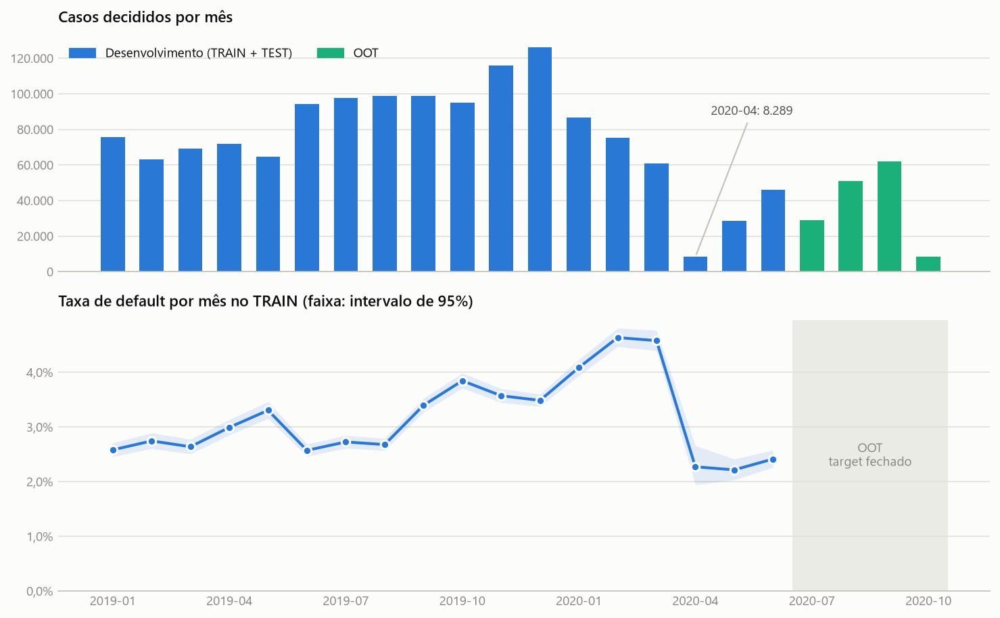
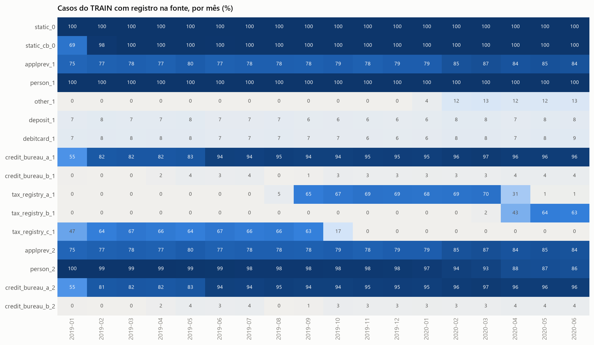
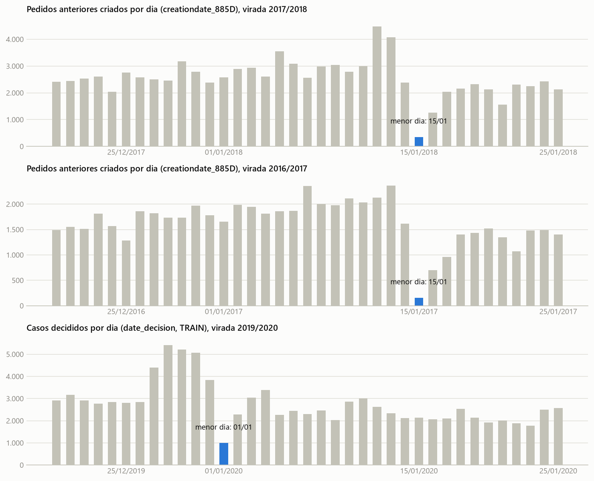

# Credit Risk Model Stability

Projeto 05 da Mentoria em Ciência de Dados. O objetivo é prever o risco de inadimplência (`target`) de
uma operação de crédito com os dados da competição
[Home Credit - Credit Risk Model Stability](https://www.kaggle.com/competitions/home-credit-credit-risk-model-stability),
usando apenas informação disponível até a data da decisão (`date_decision`) e mantendo o desempenho
estável no tempo.

**Estado atual: Semana 1 concluída (entendimento dos dados e engenharia de features).** Nenhum modelo
foi treinado ainda, como pede o enunciado; a modelagem é a Semana 2.

## Entregáveis da Semana 1

| Entregável | Onde | O que contém |
|---|---|---|
| EDA | [`notebooks/01_eda.ipynb`](notebooks/01_eda.ipynb) | população, TRAIN/TEST/OOT, volume e default no tempo, mapa e cobertura das fontes, qualidade das colunas |
| Feature engineering | [`notebooks/02_feature_engineering.ipynb`](notebooks/02_feature_engineering.ipynb) | auditoria temporal, features por fonte, diagnóstico no TRAIN (missing, PSI, IV), decisões, Master Table, checklist |
| Master Table | `data/processed/master_table.parquet` | 1.526.659 linhas (1 por `case_id`), 62 colunas: 5 da `train_base`, `split` e 56 features |
| Catálogo de features | [`reports/feature_catalog.csv`](reports/feature_catalog.csv) | para cada uma das 74 candidatas: fonte, regra, hipótese, disponibilidade na decisão e como foi verificada, risco de leakage, missing, IV, PSI, decisão e motivo |
| Inventário das fontes | [`reports/source_inventory.csv`](reports/source_inventory.csv) | as 16 fontes: linhas, casos, cobertura, hipótese e decisão |
| Auditoria de datas | [`reports/date_audit.csv`](reports/date_audit.csv) | as 49 colunas de data das fontes usadas, comparadas com `date_decision` |
| QA da Master Table | [`reports/master_table_qa.csv`](reports/master_table_qa.csv) | 10 checagens estruturais, todas aprovadas |

A Master Table não é versionada (105 MB, acima do limite do GitHub); o notebook 02 a recria em cerca
de 2 minutos.

## O que os dados mostraram

**1. População rara em default e instável no tempo.** São 1.526.659 casos decididos entre 2019-01-01 e
2020-10-05. No TRAIN, 3,26% são inadimplentes (35.855 de 1.101.135). A taxa mensal vai de 2,6% no
início de 2019 a 4,6% em fevereiro de 2020 e cai para 2,2% a 2,4% entre abril e junho de 2020, quando
o volume também desaba (8.289 casos em abril de 2020, contra 126 mil em dezembro de 2019). O OOT vem
logo depois desse período atípico.



**2. A disponibilidade das fontes externas muda no tempo, e isso é a maior ameaça à estabilidade.**
Três fornecedores de registro fiscal se revezam (C até 2019-09, A de 2019-09 a 2020-04, B a partir de
2020-04); o bureau A cobre 55% dos casos em janeiro de 2019 e 94% ou mais só a partir de junho; e
nos cinco primeiros meses de 2019 ele informa quantos contratos encerrados o cliente tem, mas não
envia os contratos.



**3. As datas das tabelas secundárias estão 14 dias adiantadas.** Lidas como estão gravadas, 100% das
deduções fiscais de um fornecedor e 2% dos "pedidos anteriores" seriam posteriores à decisão. Mas
nenhum evento passa de exatamente +14 dias, e os feriados denunciam o deslocamento: o vale do Ano
Novo cai em 1º de janeiro em `date_decision` e em 15 de janeiro nas datas dos pedidos anteriores do
mesmo credor. Os campos de (ano, mês) estão 1 mês adiantados. Corrigido o calendário, **nenhum**
dos 20,3 milhões de valores de data usados nas features (TRAIN) é posterior à decisão.



**4. O histórico de atraso domina o sinal, sem indício de leakage.** O maior IV no TRAIN é 0,40
(proporção de pagamentos atrasados no bureau nos 12 meses antes da decisão); nenhum passa do limite
de atenção de 0,5. As seis features com IV acima de 0,3 foram investigadas uma a uma: a taxa de
default cresce de forma monótona com o atraso e a pior faixa tem 11% de default, longe do que um
vazamento do target produziria.

**5. Capacidade de pagamento declarada quase não separa.** As razões parcela/renda e crédito/renda têm
IV abaixo de 0,01: a carteira já foi aprovada por uma política que limita esse comprometimento.

## Estratégia de dados

```
2019-01 ─────────────────────────────────── 2020-06 | 2020-07 ───── 2020-10
        DESENVOLVIMENTO (1.376.419 casos)           |   OOT (150.240 casos)
        ├── TRAIN 80% (1.101.135)                   |   fechado até a avaliação
        └── TEST  20% (275.284)                     |   final da Semana 2
```

- OOT = meses 2020-07 a 2020-10, como manda o enunciado. O restante é dividido ao acaso, 80/20,
  estratificado pelo target, com `random_state=42`. A regra está em `src/split.py` e o resultado é a
  coluna `split` da Master Table.
- **Só o TRAIN** é usado em tudo o que envolve o target (taxa de default, IV) ou a distribuição das
  features (missing, PSI, redundância). Do OOT só se leu o número de casos por mês.
- As features são fórmulas fixas dos registros do próprio caso: não há parâmetro aprendido nos
  dados, então TRAIN, TEST e OOT são calculados exatamente da mesma forma.

## Ponto de observação (prevenção de leakage)

| Tipo de campo | Como está gravado | Tempo até a decisão |
|---|---|---|
| data em dia (sufixo `D`) | 14 dias adiantada | `date_decision - (data - 14 dias)` |
| par (ano, mês) (sufixo `T`) | 1 mês adiantado | `mês da decisão - (ano/mês - 1 mês)` |

- Os deslocamentos são constantes em `src/config.py` (`DATE_SHIFT_DAYS`, `MONTH_SHIFT`) e todo cálculo
  de tempo passa por `days_before_decision` e `months_before_decision` em `src/features.py`.
- O corte é aplicado no código, antes de agregar: registro com tempo negativo é descartado.
- Um teste automático acrescenta registros posteriores à decisão a todas as tabelas de histórico e
  exige que nenhuma feature mude (`tests/test_features.py`).
- O contrato em análise não aparece nos históricos: os "pedidos anteriores" do mesmo dia são
  tentativas canceladas ou recusadas, e nenhum contrato recém-aberto no bureau é do próprio credor.

A correção de calendário é uma **inferência a partir dos dados** (a documentação oficial só diz que
as datas foram "transformadas"). Quem preferir a leitura literal pode pôr as duas constantes em 0 e
reexecutar o notebook 02: o corte passa a descartar os 14 dias mais recentes de histórico.

## Master Table

Uma linha por `case_id`, com `case_id`, `date_decision`, `WEEK_NUM`, `MONTH`, `target`, `split` e 56
features (26 colunas originais selecionadas e 30 autorais), de 9 das 16 fontes:

| Família | Fonte | Features | Exemplos |
|---|---|---|---|
| Pedido em análise | `static_0` | 5 | `credamount_770A`, `annuity_780A`, `pmtnum_254L`, `eir_270L` |
| Dívida e comportamento com o credor | `static_0` | 13 | `avgdpdtolclosure24_3658938P`, `pctinstlsallpaidlate1d_3546856L`, `maxdpdlast3m_392P`, `days_since_last_delinquency` |
| Procura recente e contatos | `static_0` | 5 | `applications30d_658L`, `lastst_736L`, `days_since_last_rejection`, `mobilephncnt_593L` |
| Consultas ao bureau | `static_cb_0` | 3 | `days30_165L`, `days120_123L`, `days360_512L` |
| Solicitante | `person_1` | 3 | `age_years`, `incometype_1044T`, `mainoccupationinc_384A` |
| Pedidos anteriores | `applprev_1` | 10 | `prev_share_rejected`, `prev_n_applications_3m`, `prev_share_contracts_dpd` |
| Contratos no bureau | `credit_bureau_a_1` | 8 | `cb_share_contracts_dpd`, `cb_active_max_dpd`, `cb_days_since_last_credit` |
| Pagamentos no bureau (depth 2) | `credit_bureau_a_2` | 4 | `cb_pmt_share_late_12m`, `cb_pmt_max_dpd_3m`, `cb_pmt_months_since_last_late` |
| Registro fiscal unificado | `tax_registry_a/b/c_1` | 1 | `tax_n_deductions` |
| Razões entre fontes | várias | 4 | `annuity_to_income`, `credit_to_income`, `cb_debt_to_income`, `credit_to_prev_max_credit` |

Convenções que a Semana 2 precisa conhecer:

- **Nulo significa "não existe" ou "desconhecido"**, nunca zero: recência nula = o evento nunca
  ocorreu; feature de bureau nula = sem registro no bureau, ou bureau sem o detalhe dos contratos
  encerrados. As contagens de pedidos anteriores valem 0 para quem não tem histórico.
- **Nenhuma transformação aprendida**: valores extremos, categorias e escalas estão como vieram. Há
  atrasos de bureau com centenas de milhares de dias e razões enormes quando a renda declarada é
  minúscula; o tratamento deve ser ajustado só no TRAIN, dentro do pipeline de modelagem.
- As 18 candidatas descartadas e o motivo de cada uma (redundância, disponibilidade instável ou falta
  de sinal em todos os semestres) estão no catálogo. Sexo não foi incluído por ser atributo protegido.

## Como reproduzir

```bash
python -m venv .venv
.venv\Scripts\activate                      # Windows; em Linux/macOS: source .venv/bin/activate
python -m pip install -r requirements.txt
```

Dados: ver [`data/README.md`](data/README.md) (é preciso aceitar as regras da competição no Kaggle).

```bash
python -m pytest -q
python -m jupyter nbconvert --to notebook --execute --inplace --ExecutePreprocessor.timeout=-1 notebooks/01_eda.ipynb
python -m jupyter nbconvert --to notebook --execute --inplace --ExecutePreprocessor.timeout=-1 notebooks/02_feature_engineering.ipynb
```

Os notebooks devem ser executados com o ambiente virtual ativado (o kernel usa o `python` do PATH).
Na máquina de referência (Python 3.11.9, Windows 11, 32 GB de RAM) cada um leva de 1 a 2 minutos.
Os testes (64) usam tabelas sintéticas com o mesmo formato e o mesmo deslocamento de calendário dos
arquivos reais, então rodam sem os dados do Kaggle.

Reprodutibilidade: o split usa semente fixa e é independente da ordem das linhas (testado), e as
features não dependem de estado oculto. Reconstruída duas vezes do zero, a Master Table saiu
idêntica, bit a bit, à gravada pelo notebook 02.

## Estrutura

```
├── data/
│   ├── README.md                  como obter os dados
│   ├── raw/                       arquivos do Kaggle (não versionados)
│   └── processed/                 master_table.parquet (não versionada)
├── notebooks/
│   ├── 01_eda.ipynb
│   └── 02_feature_engineering.ipynb
├── reports/                       catálogo, inventário, auditorias e figuras gerados pelos notebooks
├── src/
│   ├── config.py                  caminhos, TRAIN/TEST/OOT, deslocamento do calendário
│   ├── data.py                    leitura das tabelas, com as datas convertidas
│   ├── split.py                   regra de TRAIN/TEST/OOT
│   ├── features.py                features por fonte e montagem da Master Table
│   ├── catalog.py                 hipótese, regra, verificação temporal e decisão de cada feature
│   ├── iv.py                      WoE, Information Value e PSI
│   ├── audit.py                   inventário, qualidade de colunas, auditoria de datas, diagnósticos
│   ├── qa.py                      checagens da Master Table
│   └── plots.py                   estilo e figuras
└── tests/                         64 testes com dados sintéticos
```

## Limitações

- O deslocamento de 14 dias (e de 1 mês) é inferido de padrões dos dados, não de documentação. As
  evidências são fortes e independentes, mas a escolha fica explícita e reversível.
- O significado dos códigos de status dos pedidos anteriores (`D` = recusado etc.) também é inferido.
- De 2019-01 a 2019-05 as features que dependem de contratos encerrados no bureau ficam nulas para
  cerca de 85% dos casos com bureau. A Semana 2 deve comparar o treino com todos os meses contra o
  treino a partir de 2019-06.
- `applprev_1` guarda no máximo 20 pedidos por caso: as contagens saturam em 20 (2,6% dos casos com
  histórico).
- O IV é univariado: features com IV baixo podem importar em interação, e vice-versa. A seleção
  final é tarefa da Semana 2.
- Durante o desenvolvimento, duas saídas de depuração mostraram estatísticas da base inteira, com as
  linhas do OOT misturadas às demais: a média global do target da `train_base` e um resumo da tabela
  candidata. Nenhuma estatística específica do OOT foi calculada e nenhuma decisão usou esses números.

## Próximos passos (Semana 2)

1. Baseline de Regressão Logística com pipeline ajustado só no TRAIN (imputação, tratamento de
   extremos, codificação); ROC AUC em TRAIN, TEST e OOT, com PR AUC e KS.
2. Random Forest e ao menos um Gradient Boosting; tuning; ensemble simples.
3. Estabilidade: ROC AUC por mês e por `WEEK_NUM` no OOT; comparar janelas de treino (tudo contra
   2019-06 em diante).
4. Redução de features (importância, SHAP, IV do TRAIN, redundância) e interpretação com o catálogo.
